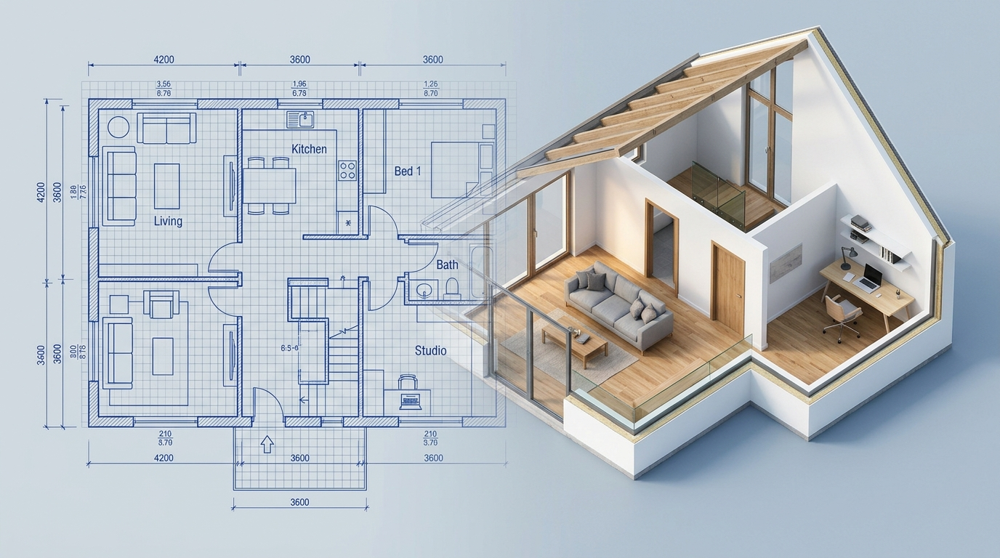

# HomeDraft-CAD

Browser-based 2D floor plan drafter and 3D home walkthrough studio.

**Live App (GitHub Pages):** [Demo](https://nesa00.github.io/HomeDraft-CAD/)

## Overview

Draw rooms in 2D, inspect them in 3D orbit or eye-level walkthrough, plan utilities and furniture, and export models for 3D printing — all directly in the browser with no backend required.

## Features

- **Structure**: Draw walls by line or rectangle, place doors and windows, customize wall colors, floors, and flat or gable ceilings.
- **Electrical, Plumbing & Security**: Route cables and pipes, connect breakers and fixtures, and check camera/sensor coverage.
- **Interior & Furniture**: Add, resize, and name furniture with live front/back/left/right clearance measurements.
- **Dimensions & Summary**: Toggle outer, inner, and 3D dimensions, room area labels, and a full project quantity summary.
- **Save & Export**: Automatic browser storage, JSON project export/import, and scaled STL/OBJ export for 3D printing.

## Run Locally

```bash
npm install
npm run dev
```

## Build & Deploy

```bash
npm run build
```